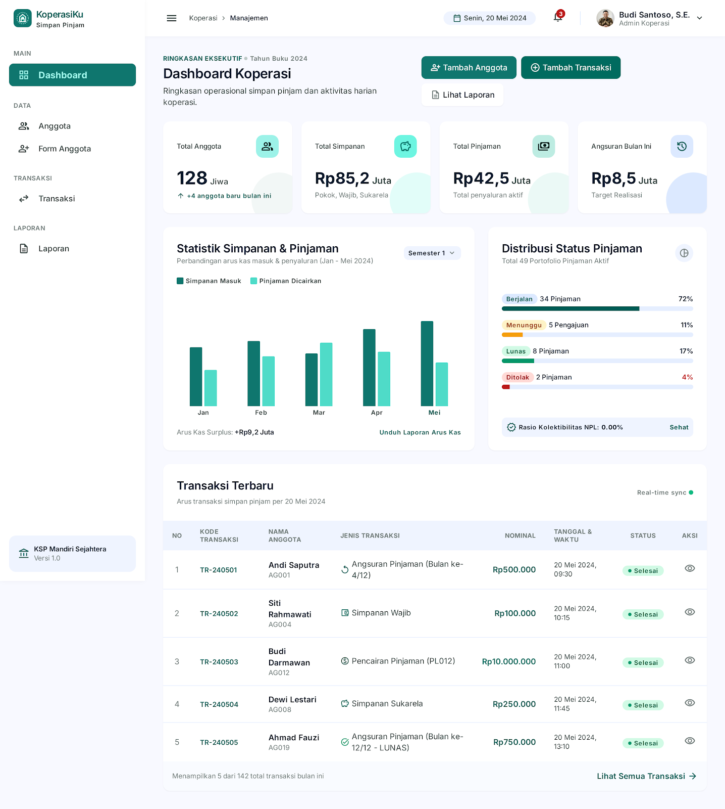
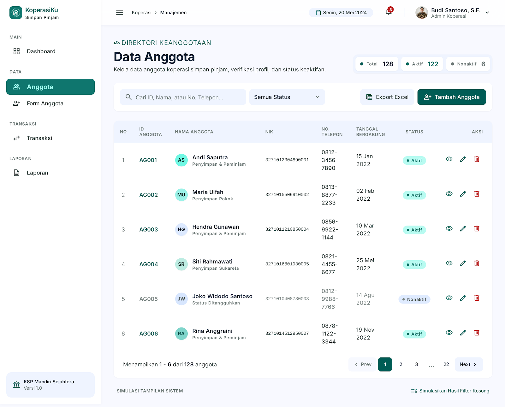
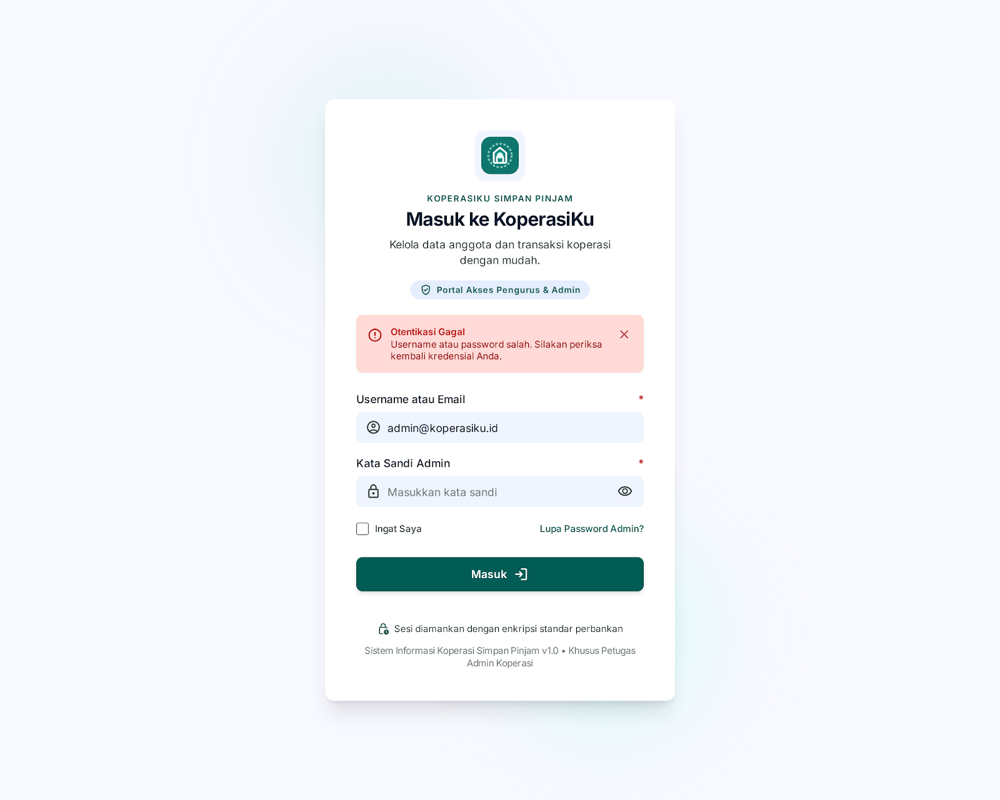
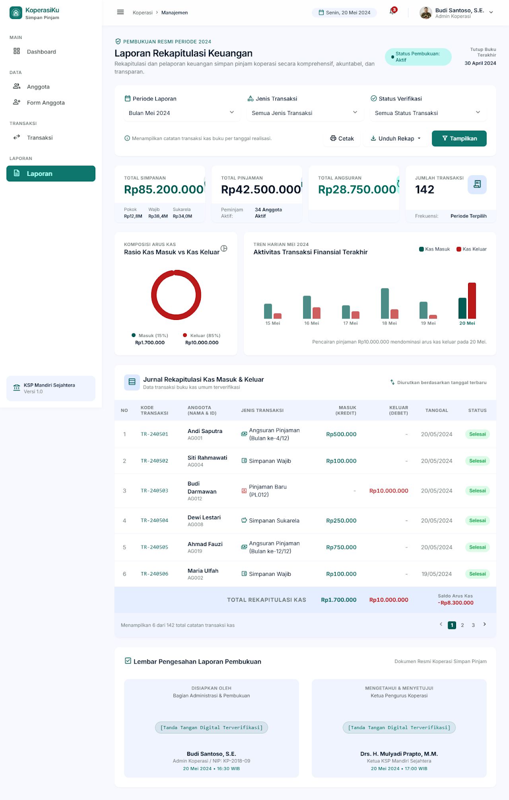

# PERANCANGAN SISTEM KOPERASIKU

Diperbarui: **17 Oktober 2026**. Dokumen ini menjelaskan implementasi aplikasi lokal terbaru, termasuk pengembangan dari rancangan awal.

## 1. Deskripsi Sistem

KoperasiKu adalah aplikasi administrasi internal koperasi simpan pinjam berbasis web. Admin mencatat anggota, setoran dan penarikan simpanan, pengajuan dan pencairan pinjaman, pembayaran angsuran, serta memeriksa kas dan laporan.

Anggota bertransaksi melalui petugas koperasi, bukan melalui akun anggota dalam aplikasi. Pencatatan pengajuan dan persetujuan pinjaman dipisahkan dari pencairan agar kas hanya berubah ketika dana benar-benar diserahkan atau diterima.

## 2. Tujuan Sistem

- Menyatukan data anggota dan riwayat transaksi.
- Membedakan pengajuan pinjaman, persetujuan, pencairan, dan pembayaran.
- Menghitung pokok, bunga kontrak, jadwal bulanan, dan sisa tagihan.
- Menjaga keterkaitan transaksi operasional dengan mutasi kas.
- Menyediakan pemantauan jatuh tempo, kuitansi, dan laporan.
- Mempertahankan riwayat koreksi melalui transaksi pembalik dan aktivitas admin.

## 3. Pengguna dan Hak Akses

| Pengguna | Hak akses |
| --- | --- |
| Admin yang sudah login | Mengelola anggota; mencatat transaksi; meninjau pengajuan; mencatat pencairan; memantau tagihan; mencetak kuitansi dan laporan; mengubah pengaturan; melihat aktivitas; mengunduh backup |
| Pengunjung dengan tautan verifikasi kuitansi | Memeriksa nomor, tanggal, nominal, dan status pembatalan kuitansi tanpa melihat identitas anggota |
| Anggota | Belum memiliki akun atau portal transaksi mandiri |

Sistem belum menerapkan pembagian peran petugas, manajer, dan super admin. Persetujuan dilakukan oleh admin aplikasi; belum ada pemisahan kewenangan antarperan.

## 4. Ruang Lingkup dan Batasan

### 4.1 Fitur yang sudah diimplementasikan

| Modul | Kemampuan |
| --- | --- |
| Login | Autentikasi admin, logout, pembatasan percobaan login |
| Dashboard | Ringkasan anggota, simpanan, pinjaman, angsuran, saldo kas, piutang, jatuh tempo, tren kas, dan transaksi terbaru |
| Anggota | Daftar, pencarian/filter, tambah, detail, edit, status aktif/tidak aktif, dan validasi identitas |
| Simpanan | Setoran Pokok/Wajib/Sukarela, penarikan Sukarela, saldo anggota, dan riwayat |
| Pinjaman | Simulasi, pengajuan, persetujuan/penolakan, pencairan, detail, jadwal, dan tinjauan pelunasan |
| Angsuran | Pencatatan dana yang diterima, pembayaran sebagian, alokasi bunga/pokok, dan pembaruan sisa tagihan |
| Jatuh Tempo | Pemantauan jadwal, tunggakan, tagihan mendekat, dan pembayaran jadwal |
| Buku Kas | Verifikasi pembukaan, mutasi masuk/keluar, saldo, akses kuitansi, dan pembatalan beralasan |
| Laporan | Tiga jenis utama: Simpanan, Pinjaman, dan Angsuran; cetak, PDF, dan Excel |
| Kuitansi | PDF bernomor tetap, QR/tautan verifikasi, serta informasi pembatalan |
| Aktivitas Admin | Jejak aktivitas dan referensi perubahan |
| Pengaturan | Identitas/logo koperasi dan versi kebijakan pinjaman |
| Backup Database | Unduhan SQL dengan konfirmasi dan pemeriksaan password admin |

Penghapusan anggota hanya diperbolehkan jika tidak memiliki histori simpanan atau pinjaman dan memenuhi pemeriksaan aplikasi. Untuk anggota yang memiliki histori atau tidak lagi bertransaksi, gunakan status Tidak Aktif. Koreksi transaksi keuangan menggunakan pembatalan yang memenuhi syarat, bukan penghapusan riwayat.

### 4.2 Batasan implementasi

- Belum ada portal anggota atau pengajuan mandiri secara online.
- Belum ada payment gateway, pembayaran online operasional, atau integrasi WhatsApp.
- Pengingat jatuh tempo berada di aplikasi; bukan pengiriman pesan otomatis ke anggota.
- Endpoint sandbox/webhook yang tersisa bukan fitur pembayaran aktif dan tidak membukukan pembayaran online.
- Perhitungan jasa simpanan lama tersedia dalam sumber, tetapi pembukuannya dinonaktifkan.
- Buku Kas mencatat arus kas; aplikasi belum merupakan sistem akuntansi lengkap dengan jurnal berpasangan, neraca, dan pembagian SHU.
- Halaman Backup menyediakan ekspor; pemulihan database bukan fitur unggah melalui halaman tersebut.

## 5. Hierarki Menu dan Halaman

~~~text
KoperasiKu
|-- Login Admin
|-- Dashboard
|-- Anggota
|   |-- Tambah Anggota
|   |-- Detail Anggota
|   '-- Edit Anggota
|-- Simpanan
|   |-- Catat Setoran
|   '-- Tarik Sukarela
|-- Pinjaman
|   |-- Simulasi
|   |-- Buat Pengajuan
|   |-- Tinjau: Setujui / Tolak
|   |-- Catat Pencairan
|   |-- Detail dan Jadwal
|   |-- Bayar Angsuran
|   '-- Tinjau Pelunasan
|-- Angsuran
|   '-- Catat Pembayaran
|-- Jatuh Tempo
|-- Buku Kas
|   |-- Kas Pembukaan
|   |-- Mutasi dan Kuitansi
|   '-- Koreksi / Pembatalan
|-- Laporan
|   |-- Simpanan
|   |-- Pinjaman
|   '-- Angsuran
|-- Aktivitas Admin
|-- Pengaturan
|-- Backup Database
'-- Logout
~~~

Menu Pinjaman menyatukan pengajuan dan pinjaman yang sudah dicairkan. Pengajuan adalah tahap awal dari pinjaman, bukan transaksi pinjaman kedua. Simulasi dan formulir pengajuan diakses dari halaman Pinjaman, bukan menu sidebar tersendiri.

| Halaman | URL lokal |
| --- | --- |
| Login | /login |
| Dashboard | /dashboard |
| Anggota | /anggota |
| Simpanan | /simpanan |
| Pinjaman | /pengajuan |
| Form pengajuan | /pinjaman/create |
| Simulasi | /simulasi |
| Detail pinjaman | /pinjaman/{id} |
| Angsuran | /angsuran |
| Jatuh Tempo | /jatuh-tempo |
| Buku Kas | /keuangan |
| Laporan | /laporan |
| Aktivitas Admin | /aktivitas |
| Pengaturan | /pengaturan |
| Backup | /backup |

Aplikasi lokal digunakan pada port **8001**. URL /pinjaman tetap kompatibel dengan daftar Pinjaman. URL /pengajuan adalah alamat halaman yang diberi label Pinjaman di navigasi.

## 6. Alur Penggunaan

### 6.1 Persiapan awal

1. Admin login.
2. Periksa identitas koperasi dan kebijakan pinjaman di Pengaturan.
3. Verifikasi uang kas yang benar-benar tersedia.
4. Masukkan tanggal, nominal, sumber/alasan, dan konfirmasi Kas Pembukaan di Buku Kas.
5. Daftarkan anggota dan pastikan statusnya Aktif.

Saldo pembukaan tidak dihitung dengan menebak total simpanan historis. Saldo simpanan anggota, piutang pinjaman, dan uang tunai koperasi adalah informasi yang berbeda. Posting transaksi operasional memerlukan pembukaan kas terverifikasi.

### 6.2 Alur simpanan

~~~mermaid
flowchart TD
    A[Anggota menyerahkan setoran] --> B[Admin membuka Simpanan]
    B --> C[Pilih anggota, jenis, tanggal, dan nominal]
    C --> D{Validasi berhasil?}
    D -->|Ya| E[Simpan transaksi]
    E --> F[Saldo simpanan anggota dan kas bertambah]
    F --> G[Kuitansi dan laporan]
    D -->|Tidak| H[Perbaiki input]
~~~

| Jenis | Makna operasional | Penarikan di aplikasi |
| --- | --- | --- |
| Pokok | Setoran dasar keanggotaan | Tidak tersedia |
| Wajib | Setoran kewajiban anggota | Tidak tersedia |
| Sukarela | Tabungan tambahan anggota | Tersedia jika saldo Sukarela dan kas cukup |

Jenis tersebut dipertahankan untuk membedakan sumber simpanan. Aplikasi belum otomatis menentukan nominal wajib, menagih simpanan wajib bulanan, atau memaksa setoran Pokok/Wajib sebagai syarat pengajuan pinjaman. Pengembalian simpanan Pokok/Wajib saat keluar dari koperasi belum menjadi alur operasional aplikasi.

Penarikan dilakukan melalui Simpanan > Tarik Sukarela. Transaksi mengurangi saldo Sukarela anggota dan kas koperasi; saldo tidak boleh negatif.

### 6.3 Alur pinjaman

~~~mermaid
flowchart TD
    A[Simulasi opsional] --> B[Buat pengajuan anggota aktif]
    B --> C[Menunggu persetujuan]
    C --> D{Keputusan admin}
    D -->|Tolak| E[Ditolak, kas tidak berubah]
    D -->|Setujui| F[Disetujui, belum ada uang keluar]
    F --> G{Dana diserahkan dan kas cukup?}
    G -->|Ya| H[Catat pencairan]
    H --> I[Kas berkurang dan jadwal bulanan dibuat]
    I --> J[Catat pembayaran angsuran]
    J --> K{Masih ada pokok atau bunga?}
    K -->|Ya| J
    K -->|Tidak| L[Lunas]
~~~

Pembuatan pengajuan, keputusan, dan pencairan adalah tiga tindakan berbeda. Admin mencatat pencairan setelah penyerahan dana benar-benar terjadi. Simulasi hanya menampilkan perhitungan dan tidak membuat pinjaman atau mutasi kas.

| Status proses | Arti |
| --- | --- |
| submitted | Menunggu persetujuan |
| approved | Disetujui, belum dicairkan |
| rejected | Ditolak |
| disbursed | Sudah dicairkan dan dapat dibayar |
| closed | Pokok dan bunga sudah lunas |
| reversed | Pencairan dibatalkan melalui koreksi yang diizinkan |
| legacy | Pinjaman historis sebelum alur keuangan baru |

Status proses dibaca bersama status Berjalan/Lunas. Status Lunas saja tidak cukup untuk membedakan kontrak yang selesai dibayar dari pencairan yang dibatalkan.

### 6.4 Alur angsuran dan pelunasan

1. Buka Angsuran > Catat Pembayaran, atau gunakan Bayar Angsuran dari Pinjaman.
2. Pilih pinjaman yang sudah dicairkan atau pinjaman historis yang masih berjalan.
3. Isi tanggal dan nominal uang yang benar-benar diterima.
4. Sistem memeriksa sisa tagihan dan mengalokasikan pembayaran.
5. Kas bertambah; sisa pokok/bunga dan jadwal terkait diperbarui.
6. Cetak kuitansi atau periksa hasilnya pada detail pinjaman, Buku Kas, dan Laporan.
7. Untuk pelunasan sekaligus, tinjau sisa kewajiban terlebih dahulu; sistem memeriksanya lagi saat pembayaran diposting.

**Tenor bulanan menentukan jumlah jadwal tagihan, bukan jumlah transaksi pembayaran.** Satu jadwal bulanan boleh dibayar melalui beberapa transaksi. Pembayaran sebagian tetap diperbolehkan pada versi sekarang.

Contoh aturan demo: pinjaman Rp1.000.000 dengan tenor 1 bulan dan bunga flat 1% menghasilkan satu jadwal tagihan Rp1.010.000. Anggota boleh membayar sekaligus Rp1.010.000, atau Rp400.000 lalu Rp610.000. Dua pembayaran tersebut tetap melunasi satu jadwal bulanan; tidak otomatis menambah tenor. Sisa yang belum lunas setelah tanggal jatuh tempo menjadi tunggakan.

### 6.5 Pemeriksaan dan koreksi

| Kegiatan | Halaman | Hasil |
| --- | --- | --- |
| Periksa saldo dan mutasi uang | Buku Kas | Mengetahui arus masuk/keluar dan saldo |
| Periksa jadwal/tagihan | Jatuh Tempo atau Detail Pinjaman | Mengetahui jatuh tempo dan sisa kewajiban |
| Periksa rekap transaksi | Laporan | Rekap sesuai jenis dan filter |
| Koreksi transaksi yang memenuhi syarat | Buku Kas | Transaksi pembalik, alasan, dan jejak audit |
| Simpan cadangan | Backup Database | Berkas SQL untuk disimpan secara privat |

Pembatalan mempertahankan transaksi asal. Sistem menolak pembatalan yang melanggar hubungan transaksi, saldo, atau kondisi pinjaman. Pembukaan kas hanya dapat dibalik jika belum dipakai transaksi operasional; setelah ada histori, perubahan memerlukan rekonsiliasi.

## 7. Aturan Bisnis Keuangan

Nilai berikut merupakan **aturan demo yang disetujui untuk implementasi awal**, bukan pernyataan aturan umum semua koperasi.

| Parameter | Aturan |
| --- | --- |
| Bunga pinjaman | Flat 1% per bulan pada kebijakan awal |
| Pokok maksimum | Rp10.000.000 |
| Tenor | 1–36 bulan |
| Kelayakan | Anggota Aktif; satu pengajuan/pinjaman aktif per anggota |
| Pencairan | Pengajuan disetujui dan kas cukup |
| Jadwal | Bulanan sejak tanggal pencairan; tanggal yang tidak ada dijepit ke akhir bulan |
| Hari libur | Tidak menggeser tanggal jatuh tempo |
| Pembayaran | Jadwal tertua lebih dahulu; bunga lalu pokok pada setiap jadwal |
| Pembayaran sebagian | Diperbolehkan, tidak melebihi sisa kewajiban |
| Denda dan biaya admin | Tidak dikenakan |
| Pelunasan dini | Seluruh sisa bunga kontrak tetap dibayar |
| Pembulatan | Rupiah bulat HALF_UP; selisih pada cicilan terakhir; perhitungan BigDecimal |
| Penyimpanan | Nominal disimpan dalam DECIMAL(15,2); pecahan historis tetap dipertahankan |
| Tanggal posting | Asia/Jakarta; tidak di masa depan atau sebelum pembukaan/mutasi kas terakhir |

Bunga flat dihitung dari pokok awal: total bunga = pokok × tarif bulanan × tenor. Total kewajiban = pokok + total bunga.

Pengaturan memungkinkan perubahan tarif, batas pokok, dan tenor dalam batas validasi aplikasi. Perubahan memerlukan konfirmasi dan membuat versi kebijakan baru. Pengajuan menyimpan snapshot kebijakan agar perubahan berikutnya tidak mengubah kontrak yang sudah dibuat.

Pinjaman legacy mempertahankan sisa historis tanpa membuat bunga atau jadwal baru berdasarkan tebakan. Pembayaran baru tetap dicatat ke kas setelah pembukaan diverifikasi.

## 8. Validasi Input dan Integritas Transaksi

| Input/proses | Validasi |
| --- | --- |
| Nama anggota | Huruf Unicode, spasi, titik, apostrof, dan tanda hubung; diawali huruf; tanpa angka; maksimal 255 karakter |
| NIK | Tepat 16 digit angka dan unik |
| Telepon | Hanya angka, maksimal 15 digit; tidak menerima spasi atau tanda tambah |
| NIK/telepon | Disimpan sebagai teks agar nol awal tidak hilang |
| Alamat | Teks yang boleh mengandung angka, misalnya nomor rumah |
| Nama koperasi | Tidak mengikuti larangan angka pada nama orang |
| Jenis kelamin/status | Harus sesuai pilihan yang disediakan |
| Nominal/tenor | Format angka, batas nilai, dan aturan keuangan diperiksa server |
| Kolom desimal | Menerima desimal jika sesuai kolom; notasi ilmiah seperti 1e3 ditolak |
| Form tambah/edit | Pembatasan ketik/paste dan pesan validasi di browser; tetap divalidasi ulang di server |
| Transaksi berulang | Kunci idempotensi unik dan pemeriksaan kesamaan permintaan |
| Perubahan saldo bersamaan | Transaksi database dan penguncian baris untuk mencegah saldo tidak konsisten |

Pemeriksaan browser membantu pengguna mengisi data; server tetap menjadi penentu validitas. Aturan nama orang tidak diterapkan ke alamat, email, atau nama institusi.

## 9. Perancangan Data

### 9.1 Tabel utama

| Tabel | Fungsi |
| --- | --- |
| users | Akun admin |
| anggota | Identitas dan status anggota |
| simpanan | Setoran/penarikan dan jenis simpanan |
| pinjaman | Pokok, tenor, sisa, status proses, dan snapshot kebijakan |
| angsuran | Riwayat pembayaran dan komponen bunga |
| financial_policies | Versi aturan pinjaman |
| cash_book | Status verifikasi dan tanggal kas pembukaan |
| financial_transactions | Identitas transaksi, pelaku, referensi, idempotensi, dan pembatalan |
| ledger_entries | Mutasi kas bertanda positif/negatif |
| loan_schedules | Jadwal bulanan beserta pokok/bunga dan jumlah yang sudah dibayar |
| payment_allocations | Pembagian satu pembayaran ke satu atau beberapa jadwal |
| receipts | Nomor kuitansi, hash token verifikasi, dan token terenkripsi |
| activity_logs | Jejak aktivitas admin |
| cooperative_identity | Identitas dan logo koperasi |
| pengaturan_koperasi | Pengaturan lama, termasuk status nonaktif pembukuan jasa simpanan |

### 9.2 ERD konseptual

Diagram menampilkan relasi utama; tabel teknis Laravel dan sebagian atribut tidak ditampilkan.

~~~mermaid
erDiagram
    USERS ||--o{ FINANCIAL_TRANSACTIONS : mencatat
    USERS o|--o{ ACTIVITY_LOGS : melakukan
    ANGGOTA ||--o{ SIMPANAN : memiliki
    ANGGOTA ||--o{ PINJAMAN : mengajukan
    ANGGOTA o|--o{ FINANCIAL_TRANSACTIONS : terkait
    FINANCIAL_POLICIES o|--o{ PINJAMAN : menjadi_acuan
    PINJAMAN o|--o{ FINANCIAL_TRANSACTIONS : terkait
    PINJAMAN ||--o{ ANGSURAN : dibayar
    PINJAMAN ||--o{ LOAN_SCHEDULES : memiliki
    FINANCIAL_TRANSACTIONS o|--o| SIMPANAN : mereferensikan
    FINANCIAL_TRANSACTIONS o|--o| ANGSURAN : mereferensikan
    FINANCIAL_TRANSACTIONS ||--o| LEDGER_ENTRIES : mengubah_kas
    FINANCIAL_TRANSACTIONS ||--o| RECEIPTS : memiliki
    FINANCIAL_TRANSACTIONS ||--o{ PAYMENT_ALLOCATIONS : dialokasikan
    LOAN_SCHEDULES ||--o{ PAYMENT_ALLOCATIONS : menerima
    FINANCIAL_TRANSACTIONS o|--o| FINANCIAL_TRANSACTIONS : dibalik_oleh
~~~

Satu anggota dapat memiliki banyak pinjaman sepanjang waktu, tetapi aturan aplikasi membatasi pengajuan/pinjaman aktifnya. Satu pinjaman mempunyai banyak jadwal dan pembayaran. Satu pembayaran dapat melunasi bagian dari beberapa jadwal; satu jadwal dapat menerima beberapa pembayaran.

Ledger hanya dibuat untuk peristiwa yang mengubah kas. Pengajuan dan keputusan tetap tercatat sebagai transaksi proses tanpa mutasi kas. Data historis dapat belum mempunyai referensi transaksi baru, sehingga relasinya bersifat opsional.

## 10. Laporan, Kuitansi, dan Dokumen

### 10.1 Tiga laporan utama

| Jenis | Informasi |
| --- | --- |
| Simpanan | Anggota, tanggal, jenis simpanan, setoran/penarikan, dan nominal |
| Pinjaman | Anggota, pokok, status proses, sisa pokok, dan sisa bunga |
| Angsuran | Anggota, pinjaman, urutan pembayaran, tanggal, jumlah bayar, dan bunga dibayar |

Filter tersedia sesuai jenis data, seperti periode, anggota, status, dan jenis simpanan. Hasil tampilan/cetak/PDF/Excel menggunakan sumber data dan filter yang sama. Ekspor dibatasi 5.000 baris; gunakan filter lebih sempit jika melebihi batas.

Backend juga mendukung rekap anggota, tunggakan, dan kas. Ketiganya bukan pilihan utama pada halaman Laporan. Pembayaran yang sudah dibatalkan tidak dihitung sebagai angsuran efektif; jejak pembatalan tetap tersedia pada riwayat keuangan.

### 10.2 Rancangan dokumen

- Identitas/logo koperasi, judul, periode, dan filter.
- Ringkasan, tabel transaksi, total yang sesuai jenis laporan, dan area pengesahan.
- Tata letak cetak A4 dengan pengaturan tabel agar dapat dibaca lintas halaman.
- PDF laporan/kuitansi melalui Dompdf dan Excel XLSX melalui OpenSpout.
- Kuitansi menggunakan nomor tetap; pencetakan ulang tidak membuat transaksi baru.
- Verifikasi publik menggunakan token acak, bukan ID anggota; identitas anggota tidak ditampilkan.
- QR menggunakan HTTPS ketika tautan verifikasi dapat dibentuk dengan konfigurasi yang sesuai.

## 11. Rancangan UI/UX

### 11.1 Prinsip tampilan

Sidebar dikelompokkan menjadi Utama, Anggota, Keuangan, dan Administrasi. Setiap halaman memiliki judul, penjelasan singkat, tombol tindakan, filter bila diperlukan, dan isi utama dalam panel/tabel.

Ruang antarbagian, padding panel, jarak field, serta tombol diseragamkan. Pada desktop area konten memakai padding 36 px, panel umumnya 28 px, dan field/tombol utama minimal 44 px. Layar kecil menggunakan penyesuaian responsif, navigasi lipat, dan area tabel yang dapat digeser.

### 11.2 Warna dan tipografi

| Elemen | Acuan |
| --- | --- |
| Warna utama | Teal #0F766E |
| Warna utama muda | #CCFBF1 |
| Latar | #F8FAFC |
| Panel | #FFFFFF |
| Teks utama | #0F172A, dengan penyesuaian pada CSS komponen |
| Teks sekunder | #64748B |
| Border | #E2E8F0 |
| Sukses / peringatan / bahaya | Hijau / amber / merah |

Font utama Inter disimpan sebagai aset lokal. Judul halaman utama pada workspace menggunakan 28 px; ukuran lain mengikuti hierarki komponen dan media cetak. Ikon memakai Material Symbols.

### 11.3 Komponen bersama

Navigasi aktif, judul halaman, kartu ringkasan, panel, tombol, field input, pesan kesalahan, konfirmasi tindakan, filter, tabel, paginasi, serta layout dokumen cetak digunakan secara konsisten.

Aset aplikasi berada di public/css, public/js, public/fonts, dan public/build. Template halaman berada di resources/views. Folder assets/koperasiku_admin_panel berisi referensi desain, bukan halaman aplikasi yang dijalankan langsung.

## 12. Referensi Desain Awal

[Figma KoperasiKu](https://www.figma.com/design/NA6CmiWARcpyFTJdK8S0IZ/Pemograman-2?node-id=0-1)

Tautan Figma dan gambar berikut dipertahankan sebagai referensi desain awal. Susunan menu, angka, dan tampilan pada gambar tidak selalu sama dengan implementasi terbaru.

### Dashboard

### Data anggota

### Login admin

### Laporan

[Referensi design system](../assets/koperasiku_admin_panel/koperasiku_modern_admin/DESIGN.md). Folder referensi juga memuat contoh HTML dan gambar modal.

## 13. Teknologi dan Struktur Implementasi

| Lapisan | Implementasi |
| --- | --- |
| Backend | PHP, Laravel 13; lingkungan lokal yang dipakai PHP 8.4 |
| Database operasional | MySQL |
| Pengujian otomatis | PHPUnit dan SQLite in-memory |
| Antarmuka | Blade, Tailwind CSS, Alpine.js, CSS/JavaScript bersama |
| Perhitungan nominal | Brick Math / BigDecimal |
| PDF / Excel / QR | Dompdf / OpenSpout / BaconQrCode |
| Dependensi dan aset | Composer, npm, dan Vite |
| Referensi desain | Figma serta aset rancangan awal |
| Versi sumber | Git dan GitHub |

Controller menerima permintaan dan validasi; layanan Finance menangani transaksi, penguncian, aturan uang, serta koreksi. LoanCalculator menangani simulasi/jadwal. ReportData, Documents, ReceiptService, Identity, dan DatabaseBackup menangani kebutuhan laporan dan administrasi.

Di workspace pengembangan, aplikasi aktif berada di restore-local. Di repo GitHub, isi aplikasi lokal ditempatkan langsung pada folder utama. Paket InfinityFree dipisahkan dan bukan acuan implementasi dokumen ini. .env, data transaksi, backup SQL, vendor, dan node_modules tidak dipublikasikan bersama sumber.

## 14. Keamanan dan Pengujian

- Middleware autentikasi melindungi halaman operasional.
- Permintaan perubahan melalui form memakai perlindungan CSRF.
- Password disimpan sebagai hash; konfigurasi privat berada di .env.
- Percobaan login, verifikasi kuitansi, dan unduhan backup dibatasi.
- Backup meminta konfirmasi serta password admin yang sedang login.
- Data privat/logo/kebutuhan dokumen disimpan di storage privat.
- Perubahan penting dicatat dalam aktivitas admin; koreksi keuangan mempertahankan histori.
- Token kuitansi disimpan sebagai hash untuk pencarian dan dalam bentuk terenkripsi untuk kebutuhan penerbitan kembali.
- Pada versi sumber GitHub, password seeder admin ditentukan melalui LOCAL_ADMIN_PASSWORD, bukan password akun lokal yang dipublikasikan.

Verifikasi terakhir untuk salinan aplikasi lokal yang dipublikasikan: **50 tes / 645 assertions lulus**. Cakupan meliputi perhitungan, transaksi, saldo, koreksi, pembatasan akses, dokumen, validasi input, dan seeder admin. Revisi validasi input juga diperiksa melalui ketik/paste di browser.

Hasil tersebut merupakan pemeriksaan saat pengembangan, bukan klaim sertifikasi keamanan atau jaminan integrasi layanan eksternal.

## 15. Status dan Perubahan dari Rancangan Awal

Dokumen ini sudah menggambarkan aplikasi yang diimplementasikan, bukan hanya milestone rancangan antarmuka.

| Rancangan awal | Implementasi sekarang |
| --- | --- |
| Pencatatan pinjaman langsung | Pengajuan, keputusan, lalu pencairan |
| Transaksi berisi beberapa layanan | Simpanan, Pinjaman, dan Angsuran memiliki halaman operasional masing-masing |
| ERD anggota/simpanan/pinjaman/angsuran | Ditambah kebijakan, transaksi keuangan, ledger, jadwal, alokasi, kuitansi, dan audit |
| Status pinjaman Berjalan/Lunas | Ditambah status proses untuk persetujuan, pencairan, penolakan, dan koreksi |
| Angsuran hanya mengurangi sisa | Pembayaran dialokasikan ke bunga/pokok dan jadwal; pembayaran sebagian didukung |
| Belum ada verifikasi kas pembukaan | Posting operasional bergantung pada kas pembukaan yang terverifikasi |
| Laporan umum | Tiga laporan utama, cetak/PDF/Excel, filter, dan kuitansi terverifikasi |
| CRUD anggota termasuk hapus | Riwayat dilindungi; gunakan perubahan status anggota |
| Input dasar | Pembatasan angka/nama di browser dan validasi server |
| Belum ada administrasi keuangan pendukung | Aktivitas Admin, Pengaturan kebijakan, dan Backup Database |
